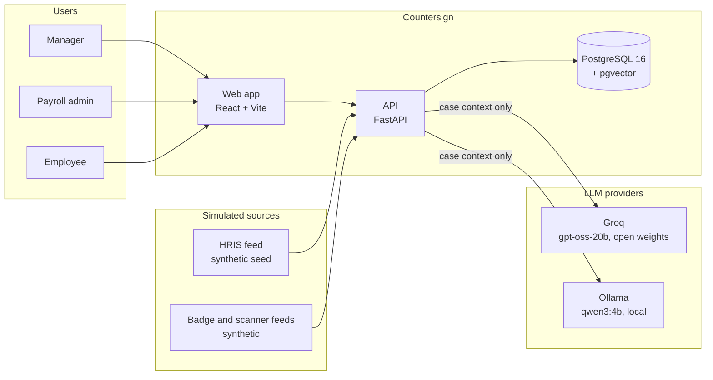
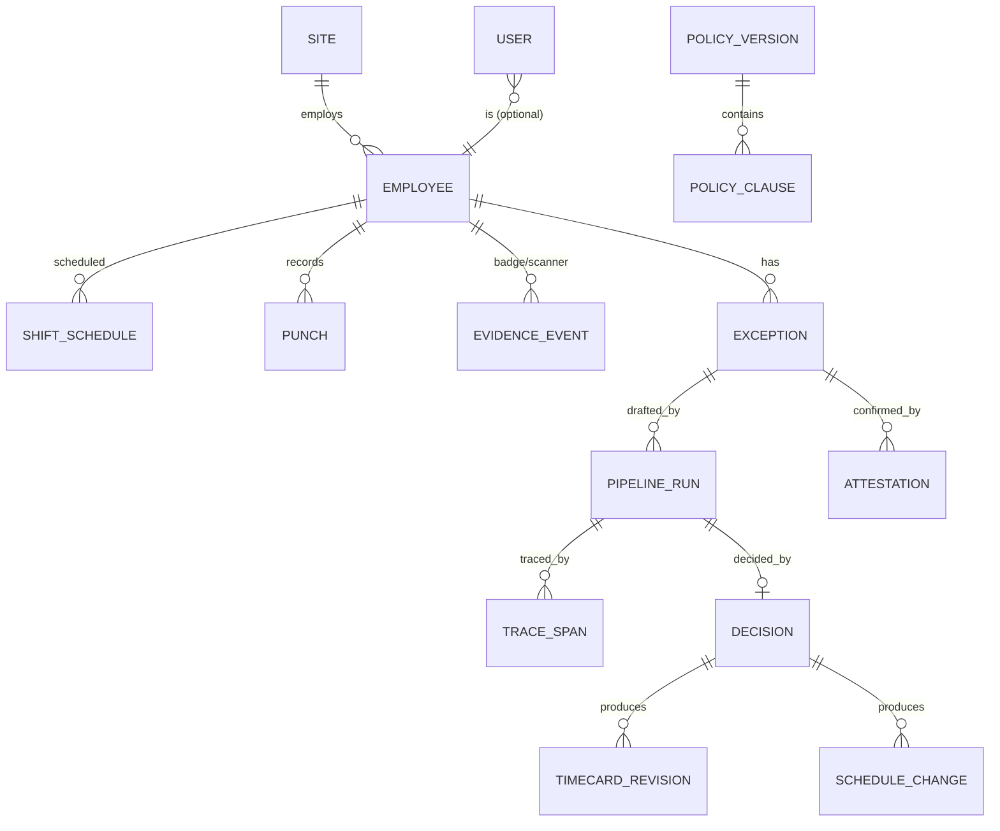
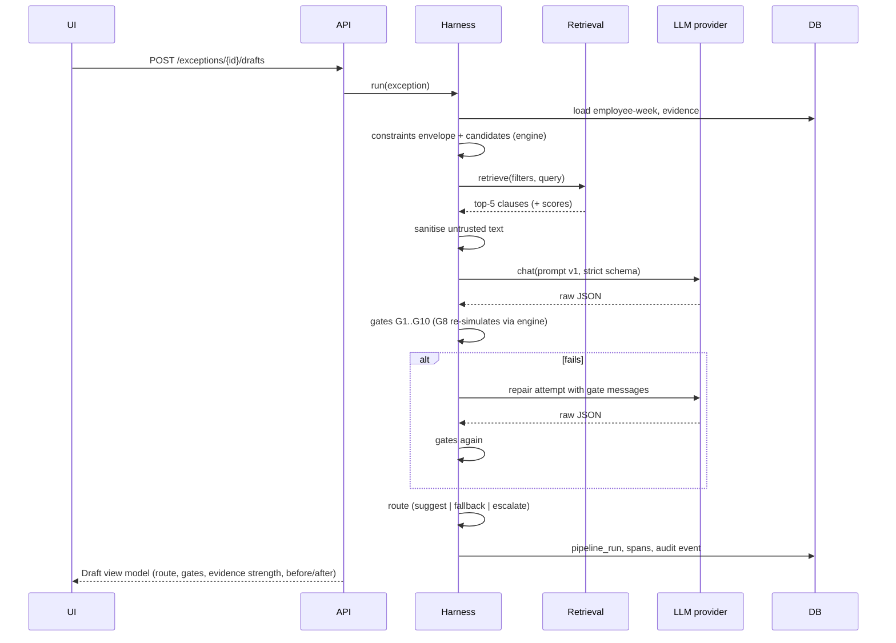

# Architecture

## 1. System context



## 2. Components

| Component | Responsibility | Key technology |
|---|---|---|
| `frontend/` | All screens, design system, typed API client | React 19, TypeScript, Vite, Tailwind v4, shadcn/ui, TanStack Query, React Router, Recharts, Motion, Zod |
| `backend/app/api` | REST routes under `/api/v1`, RBAC dependencies, problem+json errors | FastAPI, Pydantic v2 |
| `backend/app/domain` | ORM models and repositories | SQLAlchemy 2, Alembic |
| `backend/app/engine` | Punch pairing, 17 rules, constraints envelope, deterministic candidates, pay calculation, cascade linker, forecast and swaps | Pure Python, no I/O |
| `backend/app/retrieval` | Policy corpus loading, embeddings, BM25, hybrid fusion, metadata filters | fastembed, rank-bm25, pgvector |
| `backend/app/llm` | Provider protocol and implementations, prompts | openai SDK (OpenAI-compatible), httpx |
| `backend/app/harness` | Pipeline orchestration, gates G1 to G10, repair, routing, evidence strength | Pure Python |
| `backend/app/audit` | Hash-chained audit writer and verifier | SQLAlchemy |
| `backend/app/observability` | Span recorder, structured logging, request IDs | structlog |
| `backend/app/seed` | Deterministic synthetic data generator | Python, fixed seed |
| `eval/` | Labelled dataset generator, runner, metrics, reports | Python |
| `mcp/` (stretch) | Read-only MCP server exposing rules engine and policy search | `mcp` Python SDK |

Dependency rule: `api -> harness -> (engine, retrieval, llm, audit) -> domain`. `engine` depends on nothing but plain data classes, which keeps it fast to unit test.

## 3. Repository layout

```
.
├── backend/
│   ├── app/
│   │   ├── api/            routes, deps (auth, RBAC), errors
│   │   ├── contracts/      Pydantic models shared by API and harness
│   │   ├── domain/         ORM models, repositories
│   │   ├── engine/         pairing, rules, constraints, candidates, pay, cascade, forecast
│   │   ├── retrieval/      corpus, embeddings, bm25, hybrid
│   │   ├── llm/            providers (groq, ollama, rule_based, scripted), prompts/
│   │   ├── harness/        pipeline, gates, routing, confidence
│   │   ├── audit/          chain writer, verifier
│   │   ├── observability/  spans, logging
│   │   ├── seed/           synthetic data generator and loader
│   │   ├── services/       detection, view models, decisions, insights (database-facing)
│   │   ├── bootstrap.py    migrations and first-start seeding
│   │   ├── export_openapi.py
│   │   ├── config.py
│   │   └── main.py
│   ├── eval/               labelled dataset and evaluation runner
│   ├── alembic/
│   ├── policy/             policy pack: handbook, California and Bengaluru addenda (YAML)
│   ├── tests/              unit/, integration/, contract/
│   └── pyproject.toml
├── frontend/
│   ├── src/
│   │   ├── api/            generated types, client, zod schemas, query hooks
│   │   ├── components/     ui/ (shadcn), domain components (ShiftRibbon, GateStrip, ...)
│   │   ├── pages/
│   │   ├── lib/            format, keyboard, theme
│   │   └── styles/
│   ├── src/test/           Vitest
│   └── e2e/                Playwright with axe
├── eval/reports/           committed evaluation reports (JSON)
├── claude-code/            build instructions and logs
├── docker-compose.yml
├── openapi.yaml
└── .github/workflows/ci.yml
```

## 4. Data model



| Table | Notes |
|---|---|
| `sites` | code, name, timezone (IANA), jurisdiction (`US-CA`, `US-TX`, `IN-KA`), currency |
| `employees` | code, display name (synthetic), site, role, manager_id, exempt flag, hourly rate |
| `shift_schedules` | employee, start/end UTC, planned meal minutes, published flag |
| `punches` | employee, type, at UTC, source (`clock`, `correction`, `attested`), `voided_by_revision_id`; never updated in place except the void link |
| `evidence_events` | employee, kind (`badge_entry`, `badge_exit`, `scanner_activity`), at UTC, location; labelled simulated |
| `exceptions` | rule_id, severity, family, employee, work_date, evidence JSON, fingerprint (unique when open), status, root_id, policy_version |
| `pipeline_runs` | exception, attempt count, provider, model_id, prompt_version, prompt_hash, context JSON, retrieved JSON, raw outputs, parsed draft, validation reports, route, evidence_strength, latency, tokens, trace_id |
| `trace_spans` | trace_id, span_id, parent_id, name, start, end, status, attributes JSON |
| `decisions` | run, actor, action, reason_code, note, operations JSON, decided_at |
| `timecard_revisions` | decision, employee, operations applied, punches added, punches voided |
| `schedule_changes` | decision, shift, from_employee, to_employee |
| `attestations` | exception, employee, confirmed_at_time, note (untrusted), injection_flags |
| `policy_versions`, `policy_clauses` | clause metadata, text, embedding `vector(384)` (JSON array on SQLite) |
| `audit_events` | hash chain (HARNESS.md section 9) |
| `users` | demo accounts: role, site scope, optional employee link |

## 5. Key sequences

### 5.1 Draft a suggestion



### 5.2 Decide

```mermaid
sequenceDiagram
  participant UI
  participant API
  participant H as Harness
  participant E as Engine
  participant DB
  UI->>API: POST /drafts/{id}/decision {approve|edit|reject}
  API->>API: RBAC (manager of employee's site, or admin)
  alt edit
    API->>H: validate edited ops (G6..G9)
  end
  API->>DB: decision + timecard_revision (append-only)
  API->>E: re-detect employee-week
  E-->>API: exceptions after
  API->>DB: mark cleared exceptions resolved/superseded; audit events
  API-->>UI: result (cleared ids, pay after)
```

## 6. LLM provider abstraction

```python
class LLMProvider(Protocol):
    id: str            # "groq", "ollama", "rule_based", "scripted"
    model_id: str
    async def draft(self, messages: list[Message], schema: dict, params: GenParams) -> RawCompletion: ...
```

- `GroqProvider`: OpenAI SDK with `base_url=https://api.groq.com/openai/v1`, `response_format={"type":"json_schema","json_schema":{"name":"DraftResolution","strict":true,"schema":...}}`.
- `OllamaProvider`: native `/api/chat` with `format=<schema>`, `options.temperature=0`, `think=false`.
- `RuleBasedProvider`: renders the deterministic template (degraded mode).
- `ScriptedProvider`: returns configured outputs or faults (tests, eval, demo replay).

Selection by `LLM_PROVIDER` env and an admin runtime switch. Every call records provider, model, parameters, latency, tokens.

## 7. Observability

- **Spans:** each pipeline stage records a span (`trace_id`, `span_id`, `parent_id`, `name`, `start`, `end`, `status`, `attributes`) to `trace_spans`. Field names follow OpenTelemetry conventions so an OTLP exporter can be added later. The Harness Inspector reads them.
- **Logs:** structlog JSON lines with `request_id`, `trace_id`, `actor`, `route`, `latency_ms`.
- **Metrics:** computed on demand from tables for the outcomes dashboard (no separate metrics store needed at this scale).
- **Health:** `GET /api/v1/health` (liveness) and `GET /api/v1/health/ready` (database, embeddings loaded, provider reachability).

## 8. Deployment

- `docker-compose.yml`: `db` (pgvector/pgvector:pg16, health check), `api` (Python 3.12 slim, runs migrations and seed on start, health check), `web` (Node build served by nginx with `/api` reverse proxy), `ollama` (optional profile `local-llm`).
- No-Docker path: `uv run` for the API with `DATABASE_URL=sqlite:///./countersign.db`; `npm run dev` for the web app with a Vite proxy.
- Configuration via `.env` (see `.env.example`). Secrets never committed.
- Cloud deployment: not included; a proposal will be raised before adding one.

## 9. Key technical decisions

See `claude-code/DECISION.md` for context, alternatives, evidence, and revisit conditions. Highlights: plain Python pipeline (no LangGraph), Postgres with pgvector plus SQLite fallback, gpt-oss-20b on Groq with strict schema plus local Qwen3, hybrid retrieval with metadata filters, harness-computed confidence, append-only revisions, hash-chained audit, code-first OpenAPI with a committed snapshot and drift check.
