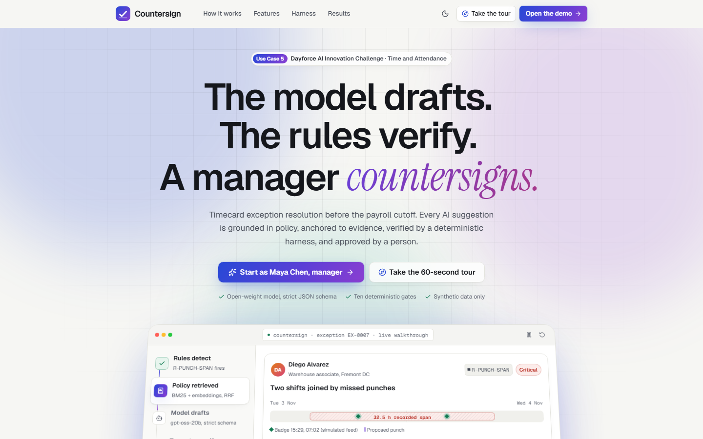
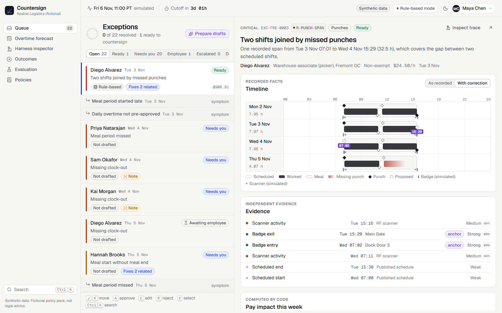
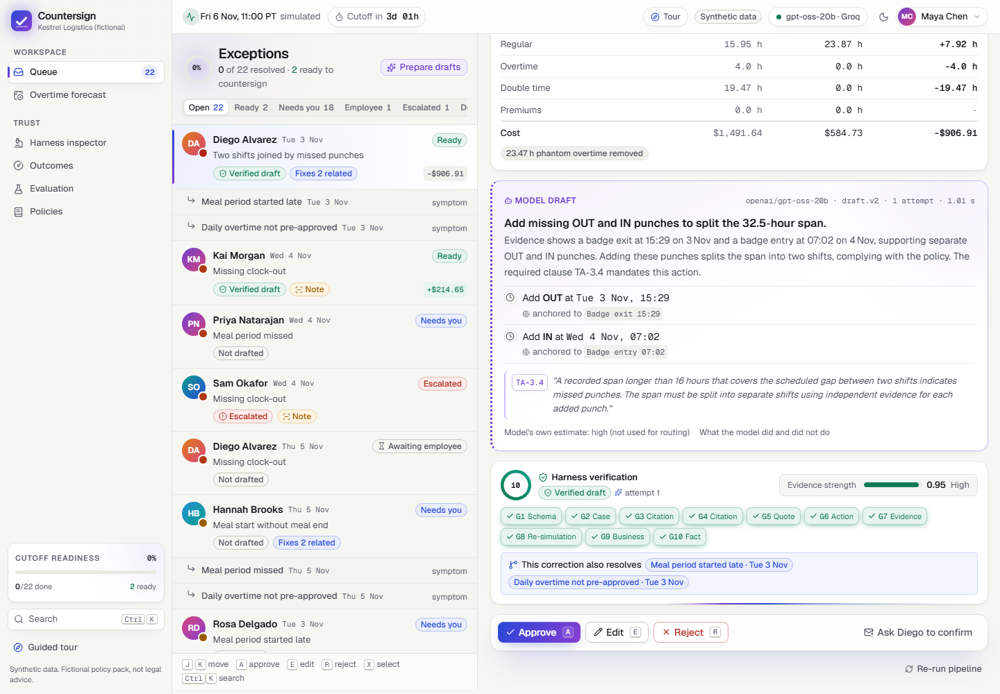
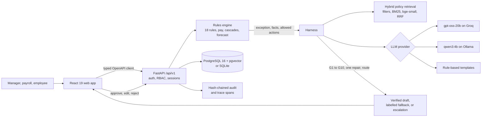

# Countersign

**The model drafts. The rules verify. A manager countersigns.**

Countersign is a timecard exception resolution agent for the Dayforce AI Innovation Challenge, Use Case 5 (Time & Attendance). A deterministic rules engine detects missed punches, overtime risks, schedule conflicts, and policy breaches. An open-weight LLM drafts a compliant correction grounded in retrieved policy and independent evidence. Ten deterministic gates verify every draft, and nothing changes a timecard until a manager countersigns it.

> **Demo video:** https://drive.google.com/file/d/1w5eJb8_-sl48w52mSOP0ZjDSUaadHyZj/view?usp=sharing

[](https://github.com/sampv69git/Dayforce/actions/workflows/ci.yml)


-6D3FD1)



## The problem and the solution

Before every payroll cutoff, managers clear timecard exceptions by hand, from a flat list with no priority, explanation, or pay impact. One missed punch creates several downstream exceptions, missing times get guessed, and overtime is found after it has been worked. Mistakes mean underpaid employees, wage claims, and audit findings.

| Use Case 5 asks for | Countersign detects | Countersign proposes |
|---|---|---|
| Missed punches | Missing in or out, shifts joined into one span, duplicate taps, open meals | A punch anchored to badge, scanner, or employee confirmation; escalation when evidence conflicts |
| Overtime risks | Daily, weekly, and seventh-day overtime, plus a forecast from the remaining schedule | A shift swap to a colleague who passes eight rule checks, or pre-approval |
| Schedule conflicts | Overlapping shifts and rest shortfalls in the published schedule, before the shift | Moving the shift through the same eight checks |
| Policy breaches | Meal, rest, and holiday rules for California, Texas, and Bengaluru | The premium owed, never an edit that hides the breach |
| Compliant corrections | Ten gates: verbatim quotes, evidence anchoring, re-simulation | Nothing is applied until a named person countersigns |

## Key features

- **Root-cause cascades.** One approval resolves a root problem and the exceptions it caused, found by counterfactual simulation.
- **Pay impact before approval.** Regular, overtime, double time, premiums, and cost, before and after the fix.
- **Prevention, not just correction.** An overtime forecast and schedule-conflict checks with compliant swap suggestions.
- **A visible harness.** Gate results, evidence strength computed by code, and a trace inspector with live fault replay.
- **Prompt-injection defence.** Employee notes are untrusted data; injected instructions are flagged and blocked.
- **Manager workflow.** A risk-ranked queue, a cutoff briefing computed from data, keyboard-first triage, guided tours, and an employee mobile confirmation screen.
- **Governance.** Append-only corrections, a SHA-256 hash-chained audit log, and a rule-based mode that keeps working without a model.
- **Secure access.** Registration, scrypt password hashing, account lockout, revocable sessions, and role-based access on every route.

| Root cause with evidence and pay impact | gpt-oss-20b draft verified by all ten gates |
|---|---|
|  |  |

## Architecture



1. **Detect.** A pure Python engine pairs punches (overnight and DST safe), runs 18 rules, computes pay, and links cascades.
2. **Ground.** Hybrid retrieval selects policy clauses by jurisdiction, employee class, and effective date.
3. **Draft.** The model receives verified facts and a code-built set of allowed actions. It explains and proposes; it never detects, computes pay, or writes.
4. **Verify.** Ten gates check every claim. A failure gets one guided repair, then a visible rule-based fallback or an escalation to payroll.
5. **Countersign.** A person approves, edits (re-validated), or rejects. Every decision is an append-only revision in the audit chain.

**The ten gates:** G1 schema · G2 case binding · G3 citation exists · G4 retrieved and required · G5 verbatim quote · G6 allowed action · G7 evidence anchoring · G8 re-simulation · G9 business guardrails · G10 fact and injection check.

## Tech stack

| Area | Technology |
|---|---|
| Backend | Python 3.12, FastAPI, Pydantic v2, SQLAlchemy 2, Alembic, structlog |
| Database | PostgreSQL 16 with pgvector; SQLite for local development and tests |
| LLM | `openai/gpt-oss-20b` (Apache 2.0) on Groq with strict JSON schema; `qwen3:4b` on Ollama; rule-based fallback |
| Retrieval | BM25 and `BAAI/bge-small-en-v1.5` embeddings, fused by reciprocal rank fusion |
| Frontend | React 19, TypeScript, Vite, Tailwind CSS v4, Radix UI, TanStack Query, Motion |
| Contract and interop | OpenAPI 3.1 generated from code with a typed client; read-only MCP server for other agents |
| Quality | pytest, Schemathesis, Vitest, Playwright with axe-core, GitHub Actions |

## Results

Measured on 128 hand-labelled synthetic cases (`eval/reports/latest.json`):

| Measure | Result |
|---|---|
| Detection precision / recall | 1.000 / 1.000 |
| Hybrid retrieval, required clause in top 5 | 1.000 |
| Injected faults caught (12 kinds x 12 cases) | 144 of 144, 0 unsafe drafts shown |
| Prompt-injection cases resisted | 8 of 8 |
| gpt-oss-20b on Groq (30 cases) | 96.7% correction accuracy, 0 unsafe drafts shown; 23.3% of first drafts would have been unsafe without the harness |

## Getting started

Requirements: Docker with Compose v2, or Python 3.12 with [uv](https://docs.astral.sh/uv/) and Node.js 22. A [Groq](https://console.groq.com/) API key is optional; without one, Countersign runs in rule-based mode and every workflow still works.

```bash
git clone https://github.com/sampv69git/Dayforce.git countersign && cd countersign
cp .env.example .env          # optional: set GROQ_API_KEY and JWT_SECRET
```

**With Docker**

```bash
docker compose up --build     # web http://localhost:8080 · API http://localhost:8000/docs
```

**Local development**

```bash
cd backend && uv sync && uv run uvicorn app.main:app --port 8000   # terminal 1, seeds itself
cd frontend && npm install && npm run dev                          # terminal 2, http://localhost:5173
```

**Signing in.** Create an account from **Sign in > Create an account**, or use a synthetic account with the password `Countersign2026`:

| Account | Role |
|---|---|
| `maya.chen@kestrel.example` | Manager, Fremont |
| `arjun.rao@kestrel.example` | Payroll admin, all sites (switch model provider, reset data, replay faults) |
| `diego.alvarez@kestrel.example` | Employee |

All settings are documented in `.env.example`. The clock is simulated (Fri 6 Nov 2026, 11:00 PT) so the cutoff and forecasts are reproducible.

## Testing

| Check | Command |
|---|---|
| Backend tests (unit, integration, API contract) | `cd backend && uv run pytest -q` |
| Evaluation with quality gates | `cd backend && uv run python -m eval.run --providers scripted,rule_based --gate` |
| Frontend unit tests | `cd frontend && npm test` |
| End-to-end and accessibility | `cd frontend && npx playwright test` |
| Lint, types, and all of the above | `make check` |

CI runs the backend, evaluation, frontend, and secret-scan jobs on every push.

## Project structure

```
backend/      FastAPI app: api, auth, engine, harness, retrieval, llm, services, audit; policy pack, eval, tests
frontend/     React app: pages, components, typed API client, Playwright journeys
eval/         Committed evaluation reports
demo-video/   Reproducible pipeline that records the live app and composes the demo video
openapi.yaml  API contract generated from code
```

---

Countersign makes no claim of legal compliance. Every correction is a draft until a person countersigns it.
